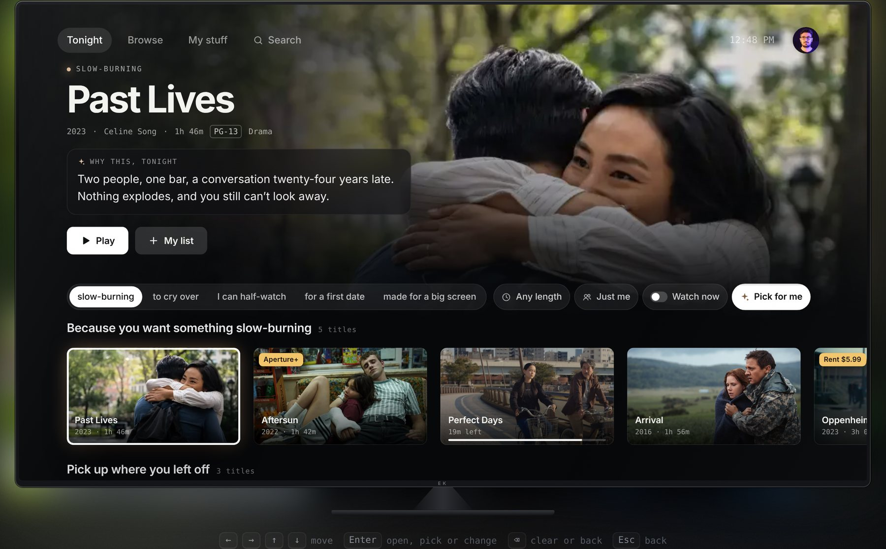
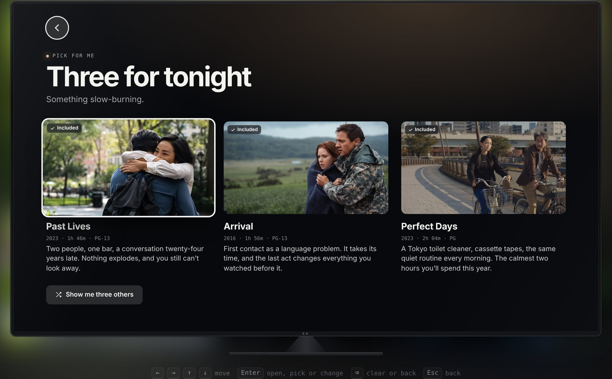
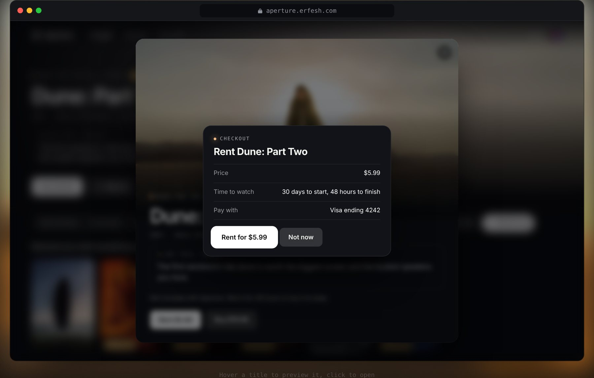
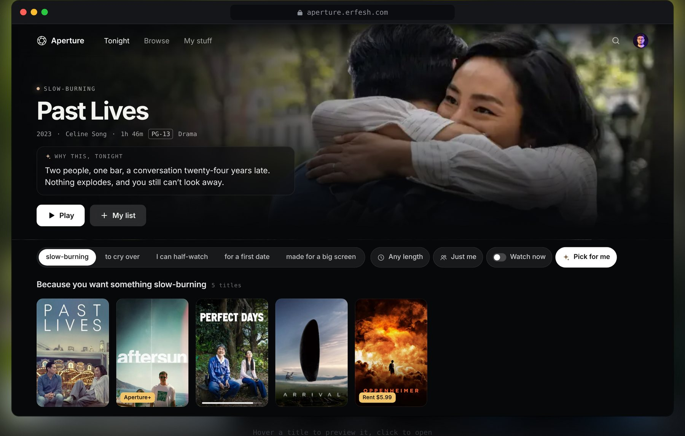
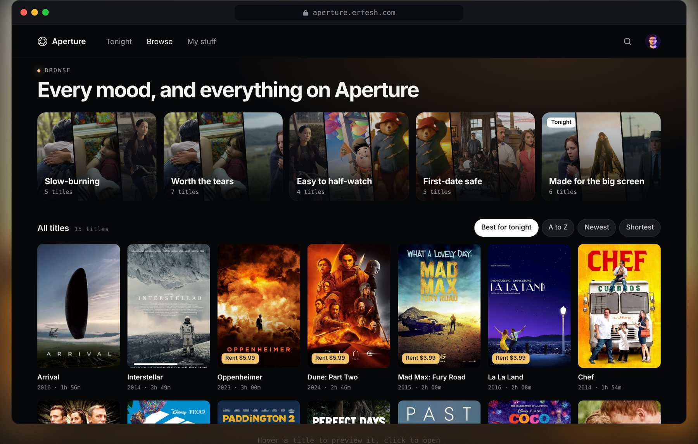
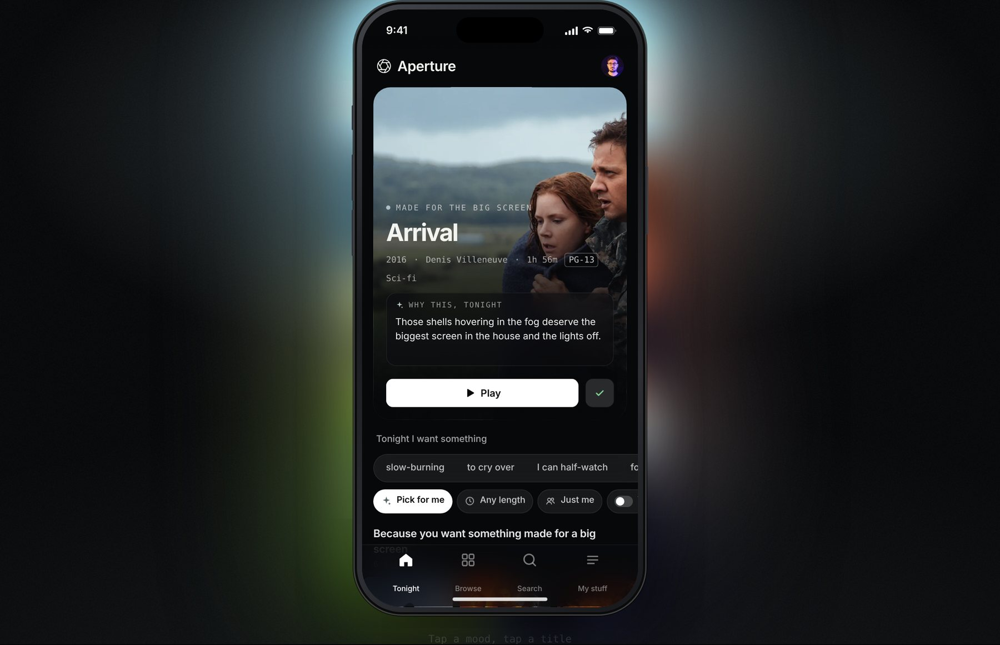

# Aperture

**Pick a mood, not a genre.** A streaming home screen prototype that starts from how you want tonight to feel, tells you why each film fits, and is honest about what everything costs. Built for TV, web and phone.

**Live demo:** https://erfesh.github.io/aperture



## The idea

For five years I've written a version of one sentence for @erfesh almost every day: here's why this one, for you, tonight. Streaming apps mostly sort by genre and popularity. People don't actually choose that way, they choose by mood: what they have the attention for, who they're watching with, whether tonight can take a sad ending.

Aperture swaps genre rows for mood rows, and gives each title a short, specific reason instead of a star rating.

## What it fixes

| Problem | What Aperture does |
| --- | --- |
| **Too much choice.** Endless rows make deciding harder. | The **Tonight bar** asks the three questions people answer first: what mood, how much time, and who's watching. **Pick for me** shows three options with their reasons, and "show me three others" walks through the next best three. |
| **Hidden prices.** Included titles, rentals and add-ons sit in the same rows. | Every title that costs extra is tagged on the card. **Watch now** hides anything you'd have to pay for. Checkout is one step: the price, how long you get it, and how to cancel. Canceling Aperture+ is as easy as starting it. |
| **A cluttered Continue watching.** | Every title shows how much is left, and one tap (or the back key on a remote) clears it. |
| **Dead-end search.** | Search understands moods and constraints ("sad", "short", "kids"). When nothing matches, it says so and offers what fits your mood instead. |




## Every screen

The same app runs on three surfaces:

- **TV:** fully navigable by remote. Arrow keys move focus, Enter selects, Back returns. The home rows use endless carousels; the other pages use spatial navigation, which moves focus to the nearest item in the direction you press, the way TV operating systems do. Search has an on-screen keyboard.
- **Web:** hover a title to preview it, click to open. Carousel arrows page through each row.
- **Phone:** swipeable rows, bottom tabs, and sheets that slide up for details, checkout and profile.





## How it's built

- **React 18**, written in JSX and compiled ahead of time with **esbuild**, so the page doesn't need a transpiler in the browser. No other libraries.
- **One component tree for three devices.** Each surface renders the same product at a fixed size (1280×720 for TV, 1280×760 for web, 390×844 for phone) and scales it to fit the mockup, so layouts stay exact at any window size.
- **The "why" reasons go through a real async layer.** There's no server (the reasons are written by hand, to show the voice an AI step should match), but the client is built as if there were one: abortable requests, a cache, a short debounce while focus moves quickly, skeleton states, and a word-by-word reveal like a streamed model response.
- **Bias lighting.** A blurred copy of what's on screen glows behind the device, the way LED strips behind a TV throw the picture's colors onto the wall. The page also samples each film's key art in a canvas to tint the room.
- **Endless carousels without seams.** Rows render five copies of their titles and quietly re-center after each move. Rows too short to fill the screen don't loop.
- **Motion with restraint.** Spring easing, crossfades between titles, a slow Ken Burns drift on the hero, and a camera-iris logo that closes and opens when the mood changes. Everything respects `prefers-reduced-motion`.

## Run it

Open `index.html` in a browser. That's it.

To change the code, edit `src/app.jsx` or `src/styles.css`, then rebuild:

```
npm install
npm run build
```

Images go in `art/` as `<slug>-key.webp` (wide key art) and `<slug>-poster.webp`. The build picks them up automatically.

## Notes

Aperture is a non-commercial design prototype. Film titles and artwork belong to their studios. Prices, the Aperture+ add-on and the checkout are fictional; runtimes, directors and ratings are real.

Designed and built by **Erfan Kooshesh** · [erfesh.com](https://erfesh.com) · [LinkedIn](https://www.linkedin.com/in/erfesh)
